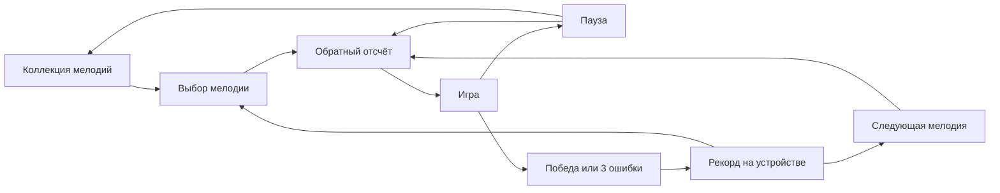
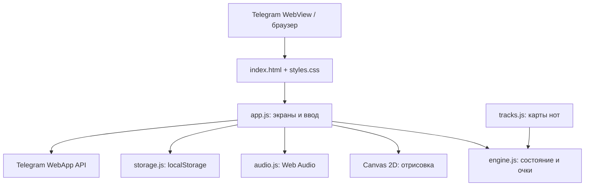
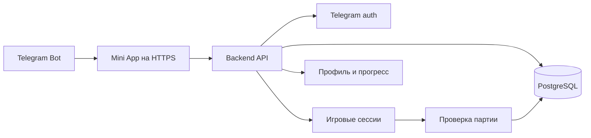

# Архитектура и план реализации Piano

Дата: 29 сентября 2026. Документ разделяет реализованный MVP и возможные следующие версии. Персонаж, экономика и выплаты ниже — план, а не готовая функциональность.

## 1. Цель первой версии

Проверить, нравится ли людям сама игра: открыть мини-приложение, выбрать мелодию, попасть по падающим клавишам и захотеть сыграть ещё. Главная метрика — повторная партия, а не количество созданных кошельков.

В MVP реализованы:

- Три уровня: «Ода к радости», «Маленькая звезда», «К Элизе».
- Четыре дорожки, попадание по центру клавиши на линии, touch/pointer и D/F/J/K.
- Обратный отсчёт, звуковая обратная связь, комбо, три жизни и завершение мелодии.
- Пауза/возобновление, повтор, переход к следующему уровню и выход к коллекции.
- Личные рекорды и пройденные уровни в браузере на устройстве.
- Оболочка Telegram: ready/expand, BackButton, безопасные отступы, виброотклик при поддержке и отключение вертикальных свайпов во время игры.
- Мобильная и настольная версии одного интерфейса.

Из MVP исключены: сервер, глобальная таблица лидеров, монеты, обмен, криптовалютные кошельки, оплата, персонаж, пассивный доход, реферальная система, реклама и административная панель.

## 2. Пользовательский путь

Все мелодии открыты сразу, чтобы можно было оценить сложность без искусственных ограничений. После победы доступна следующая мелодия. Три ошибки завершают попытку, но не сбрасывают личный рекорд. Выход из незавершённой партии не считается законченной попыткой.

## 3. Реализованная техническая архитектура

Выбран HTML/CSS + нативные JavaScript ES Modules. Для трёх коротких мелодий React, серверный рендеринг и большой игровой фреймворк увеличили бы число зависимостей без необходимости. Разделение модулей позволяет позже добавить TypeScript, компоненты интерфейса или серверный API.

| Модуль | Ответственность | Почему отдельно |
|---|---|---|
| engine.js | Тайминг, попадания, ошибки, очки, окончание партии | Тестируется без браузера; позднее может использоваться на сервере для пересчёта |
| tracks.js | Список нот, MIDI-высота, дорожка, время, длительность | Добавление контента не меняет движок |
| audio.js | Запуск аудио по жесту, гармоники, огибающие, реверберация, mute | Можно заменить синтез лицензированными сэмплами |
| storage.js | Схема локальных рекордов, валидация, обработка ошибок записи | Можно заменить адаптером серверного профиля |
| app.js | Навигация, Canvas, input, эффекты и Telegram | Объединяет платформенные API, не смешивая их с правилами |

### Игровой цикл

Время партии вычисляется от `performance.now()`, а кадры рисуются через `requestAnimationFrame`. Скорость зависит от секунд, а не количества кадров. При паузе сохраняется прошедшее время; после возобновления пересоздаётся временная точка отсчёта. Сворачивание, потеря фокуса и деактивация Telegram ставят игру на паузу.

Позиция центра ноты определяется её временем и временем подлёта. Нота достигает линии точно в свой timestamp. Обработчик ввода обновляет время перед оценкой попадания, чтобы не ждать следующего кадра. Ввод не работает в отсчёте, на паузе и на экране результатов.

| Точность | Окно от целевого времени | Базовые очки |
|---|---|---|
| Perfect | ±65 мс | 100 |
| Отлично | до ±130 мс | 80 |
| Попадание | до ±190 мс | 50 |
| Пропуск / неверная дорожка | За пределами окна / нет ожидаемой ноты | Потеря жизни, сброс комбо |

Множитель: попадания 1–10 ×1, 11–20 ×2, 21–30 ×3, 31+ ×4. Итоговая точность — сумма качества попаданий / (все ноты + ошибочные нажатия); поэтому недоигранная партия не получает 100%. Разогрев до первой ноты и затухание последней не штрафуют за пустой тап. Одна нота засчитывается один раз.

### Звук и производительность

У каждой ноты пять затухающих гармоник с небольшим расхождением частот. Общие compressor и короткая реверберация ограничивают громкость и смягчают звук. Звук запускается на попадании; внешнего фонового аудиотрека нет, поэтому синхронизация с записью не требуется. Пропущенная нота не звучит. Это синтез фортепиано, а не концертная запись.

Canvas ограничивает плотность пикселей до 2×. В каждый кадр рисуются только видимые ноты. Частицы короткоживущие; при `prefers-reduced-motion` их нет. Анимация останавливается вне партии. Для полного релиза стоит измерить стабильность кадров на недорогих Android-устройствах и добавить регулировку задержки под Bluetooth-наушники.

### Сохранения

Ключ `piano.progress.v1`: версия, настройки звука, число завершённых попыток и рекорды по trackId. Рекорд хранит максимум очков, комбо, точности и факт прохождения. Ошибочные данные нормализуются; недоступное хранилище не мешает игре. Невозможность записи показывается пользователю.

`localStorage` подходит только для локального прототипа. Оно не подтверждает личность, не защищает рекорды от изменения и не должно хранить денежные балансы.

## 4. Следующая версия: аккаунты и общий прогресс

Предлагаемая серверная архитектура — модульный монолит, а не набор микросервисов. Стек можно выбрать под инфраструктуру команды; базовый вариант: Node.js/TypeScript + Fastify, PostgreSQL, статический фронтенд на CDN. Redis нужен только при появлении измеренной нагрузки или фоновых задач; в первом серверном релизе можно обойтись без него.

Авторизация: клиент отправляет исходную строку `initData`; сервер проверяет подпись и срок действия, затем выдаёт короткую сессию. `initDataUnsafe` не используется как доказательство личности. Это соответствует [официальной документации Telegram](https://core.telegram.org/bots/webapps#validating-data-received-via-the-mini-app).

### Предлагаемые таблицы

| Таблица | Основные поля и ограничения |
|---|---|
| users | id UUID, telegram_id BIGINT UNIQUE, created_at, last_seen_at |
| tracks | id, title, bpm, difficulty, chart_version, chart_hash, active |
| game_sessions | id, user_id, track_id, chart_version, nonce, started_at, expires_at, status |
| game_results | session_id UNIQUE, score, max_combo, accuracy, completed, verified_at |
| player_progress | user_id + track_id UNIQUE, best_score, best_combo, completed_at |
| gameplay_events | session_id, batch_index UNIQUE в сессии, compact_inputs, received_at; ограниченный срок хранения |

### Предлагаемые API-контракты

| Метод | Назначение |
|---|---|
| POST /auth/telegram | Проверить initData и создать серверную сессию |
| GET /me | Профиль и прогресс |
| GET /tracks | Версионированный каталог и карты |
| POST /game-sessions | Создать сессию с trackId, nonce и версией карты |
| POST /game-sessions/:id/events | Принимать ограниченные по размеру пакеты ввода |
| POST /game-sessions/:id/finish | Идемпотентно проверить и завершить партию |
| GET /leaderboard?trackId=… | Рейтинг только проверенных результатов |

Клиент присылает последовательность тапов, а не готовый баланс. Сервер пересчитывает результаты по карте, проверяет монотонность времени, допустимую длительность, уникальность сессии и частоту запросов. Итог партии и обновление рекорда записываются в транзакции. Повторный finish возвращает тот же результат.

Пересчёт защищает от простого подменённого score, но не доказывает, что играл человек: браузерный клиент можно автоматизировать. До денежных наград нужны оценка риска, лимиты, анализ аномалий и процесс рассмотрения спорных результатов. Нельзя обещать «защиту от читов» одним подписанным chart.

## 5. План персонажа и экономики — после проверки игры

### Пианист

Персонаж имеет `level`, `xp`, выбранный облик и время последнего начисления. Активная игра даёт XP только за подтверждённые сервером партии, с дневным пределом и уменьшающимся бонусом за многократное повторение одного уровня. Платные улучшения следует отделить от честного игрового рейтинга.

Пассивное начисление вычисляется по серверному времени при обращении: `rate(level) × min(elapsed, cap)`. Нужны версионирование формул, ограничение накопления и транзакционное обновление `last_claim_at`. Не нужно запускать отдельный таймер для каждого пользователя. При изменении уровня сначала закрывается старый период начисления, затем начинается новый по новой ставке.

Точные ставки, цены и XP-кривые сейчас не задаются: без бюджета наград и данных удержания они были бы выдуманными. Начать с внутренних непереводимых очков и моделирования экономики.

### Баланс и платежи

Отдельные модели: игровые очки, платная валюта, награды с возможностью вывода. Не смешивать их в одном числе. Денежные суммы хранить целыми числами в минимальных единицах, без float. Источник истины — неизменяемый журнал операций с идемпотентными ключами, а не поле balance, которое клиент может увеличить.

Предлагаемые таблицы будущей версии: `wallet_accounts`, `ledger_transactions`, `ledger_entries`, `payment_orders`, `payment_events`, `withdrawal_requests`, `pianists`, `xp_events`, `economy_config_versions`. Каждая операция связывается с источником: game_session, payment или claim. Списание и начисление выполняются атомарно; повтор webhook не создаёт повторной награды.

Для продажи цифровых улучшений внутри Telegram используется Telegram Stars согласно [правилам платежей Telegram](https://core.telegram.org/bots/payments-stars). Stars, TON и внутриигровые очки — разные сущности. Прямая конвертация заработанных игровых очков в личные Stars пользователя не должна считаться доступной функцией по умолчанию.

Вывод криптовалюты — отдельный проектный этап: источник финансирования, резерв, пределы выплат, сеть и актив, комиссии, подтверждения транзакций, хранение ключей, повторные отправки, сверка и требования выбранных юрисдикций. До подтверждения этих условий приложение не показывает обещания обмена или фиксированный денежный курс.

## 6. Поэтапная реализация

Оценки ниже — ориентир для одного разработчика, не обязательство и не срок уже выполненной работы.

| Этап | Объём | Готовность / ориентир | Критерий завершения |
|---|---|---|---|
| 0. Игровой MVP | Дизайн, 3 мелодии, звук, игровой цикл, локальные рекорды | Реализован | Проходимые карты, обработанные ошибки, мобильный интерфейс |
| 1. Telegram-пилот | Общедоступный HTTPS, привязка бота, тест iOS/Android/Desktop | 1–2 дня после доступа к боту | Запуск из бота, звук, safe area, пауза и восстановление проверены на устройствах |
| 2. Серверный прогресс | Auth, БД, игровые сессии, серверный пересчёт, резервные копии | 5–8 дней | Нельзя записать результат за чужого пользователя, finish идемпотентен |
| 3. Качество игры | Сэмплы при необходимости, калибровка задержки, больше карт, баланс сложности | 3–7 дней | Новички завершают первую мелодию, измерена задержка и частота кадров |
| 4. Персонаж | XP, уровни, визуальная эволюция, ограниченный пассивный ресурс | 4–7 дней | Формулы на сервере, офлайн-начисления не дублируются |
| 5. Stars-покупки | Каталог, invoices, подтверждение оплаты, возвраты, поддержка | 4–7 дней | Награда выдаётся только по подтверждённой оплате, повторы безопасны |
| 6. Вывод наград | Экономическая модель, правила, провайдер, антифрод, журнал и сверка | Отдельная оценка после определения требований | Пилот с реальным резервом, лимитами и процедурой разбора ошибок |

### Приёмка перед публичным пилотом

Проверить начало/завершение каждой мелодии; попадания на границах окон; три пропуска; многократные тапы; сворачивание и возвращение; mute и запрет аудио; перезагрузку с рекордами; отказ localStorage; узкие экраны; safe area Telegram; минимум одно реальное iOS- и Android-устройство. Автоматические браузерные проверки не заменяют тесты задержки звука на телефонах.

### Что измерять в пилоте

События: `track_selected`, `game_started`, `game_paused`, `game_finished`, `game_retried`, `audio_unavailable`. Параметры: trackId, chartVersion, platform, reason, duration, accuracy. Не отправлять initData, токен бота или сырые персональные данные в аналитику. В MVP сбор аналитики ещё не подключён.

Оценивать долю начала первой партии, завершение лёгкого уровня, повтор после проигрыша, партий на сессию и возвращение на следующий день. Решение о персонаже и монетизации принимать после получения этих данных.

## 7. Эксплуатация

MVP — статические файлы, развёртывание атомарной версией с возможностью возврата к предыдущей. В репозитории нет токенов, кошельков или приватных ключей. Для публичного продукта: HTTPS, контролируемые заголовки CSP, мониторинг JS-ошибок, версионирование карт и локальной схемы, проверка размеров ассетов.

С появлением backend добавить миграции БД, резервные копии с проверкой восстановления, ограничение запросов, журнал административных действий, уведомления о сбоях и отдельные dev/staging/prod окружения. Денежные операции включать флагом только после приёмки их независимого контура.
